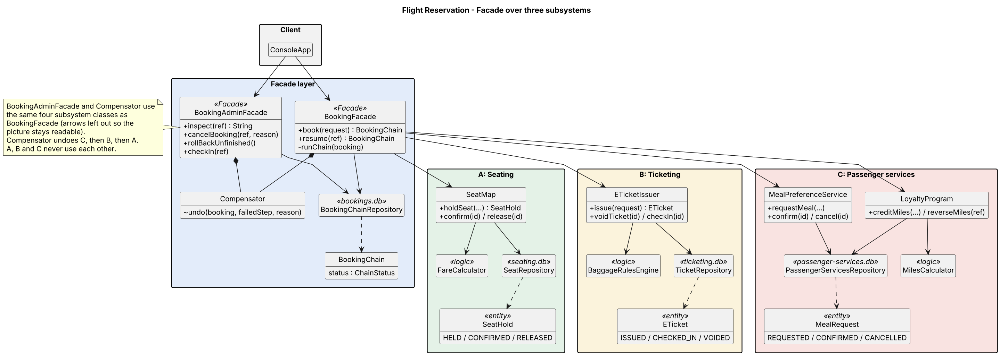

# Assignment 4 - Facade (Variant 8: Flight Reservation)

Student: Rustem Gazymbekov

The client books a flight with one call: `bookingFacade.book(request)`.
Inside, the facade goes through three subsystems in order:

- **A - seating**: holds a seat and calculates the price
- **B - ticketing**: checks passport and baggage, issues an e-ticket
- **C - passengerservices**: orders the meal and adds frequent-flyer miles, then everything is confirmed

Every subsystem has its own package, its own classes and its own SQLite file. A, B and C don't import each other,
they only meet inside the `facade` package.

| Subsystem | Classes |
|---|---|
| A seating | SeatMap, FareCalculator (logic), SeatHold (entity), Flight, SeatRepository (db) + SeatingException |
| B ticketing | ETicketIssuer, BaggageRulesEngine (logic), ETicket (entity), TicketRequest, TicketRepository (db) + TicketingException |
| C passengerservices | LoyaltyProgram, MealPreferenceService, MilesCalculator (logic), MealRequest (entity), PassengerServicesRepository (db) + PassengerServicesException |

Status of each entity:
- SeatHold: HELD -> CONFIRMED -> RELEASED (or HELD -> RELEASED)
- ETicket: ISSUED -> CHECKED_IN or VOIDED (checked in ticket can't be voided)
- MealRequest: REQUESTED -> CONFIRMED -> CANCELLED (or REQUESTED -> CANCELLED)

The entity itself throws `IllegalStateException` if the change is not allowed.

## How to run

Needs JDK 17+ and Maven.

```
mvn -q compile exec:java                         # run the console demo
mvn -q compile exec:java -Dexec.args="--reset"   # delete saved data and run
mvn test                                         # tests + coverage report (target/site/jacoco/index.html)
mvn verify                                       # same, but fails if coverage < 80%
```

**Reset:** data is saved in the `data/` folder (seating.db, ticketing.db, passenger-services.db, bookings.db).
To start clean run with `--reset`, or choose option 15 in the menu, or just delete the `data/` folder.
Demo flights and loyalty accounts are created again on the next start.

## Demo menu

- 4 - normal booking, everything works
- 5 - B fails after A (bag is 33 kg, max is 32) -> seat is released
- 6 - C fails after A and B (kosher meal on a 620 km flight, special meals only on 1000+ km) -> ticket voided, then seat released
- 7 - C fails in loyalty (account suspended) -> meal cancelled, ticket voided, seat released
- 8 - crash the program after step A, B or C. After restart it shows the unfinished booking, option 11 can continue it or roll it back
- 3 - book with your own input
- 9, 10 - list bookings / show what A, B and C saved for one booking
- 12, 13 - cancel booking / check-in (after check-in cancel is not allowed)

## How it works

There are two facades:
- `BookingFacade` - for the customer: `book()`, `resume()`, list flights, free seats, price
- `BookingAdminFacade` - for staff: `inspect()`, `cancelBooking()`, `rollBackUnfinished()`, `checkIn()`

The booking status is saved in `bookings.db` after every step:

```
STARTED -> PENDING_B -> PENDING_C -> COMPLETED
A fails       -> REJECTED (nothing to undo)
B or C fails  -> COMPENSATING -> COMPENSATED
```

`runChain()` in BookingFacade reads the saved status and does the next step until the booking is finished.
Because it only uses the saved status, the same code works after a restart (`resume()`).

Undo is done by `Compensator` (used by both facades). It doesn't look at the booking record, it asks each
subsystem what it saved for this booking ref and undoes it in order C, B, A:

| Case | Result |
|---|---|
| B fails after A | COMPENSATED, undone [A] |
| C fails after A and B | COMPENSATED, undone [B, A] |
| C fails after meal was already ordered | undone [C, B, A] |
| crash after B, record still says PENDING_B | rollback still voids the ticket because B's db has it |

Other errors:
- wrong input (empty seat, bad name, negative bag weight, unknown meal or FF number) -> `InvalidBookingException`, nothing is saved
- seat already taken -> REJECTED at step A
- ticket was checked in while booking was unfinished -> undo stops with `TicketingException`, booking stays COMPENSATING
- `BookingFailedException` is thrown when the booking ends as REJECTED or COMPENSATED

Steps can be repeated safely: `holdSeat`, `issue`, `requestMeal`, `creditMiles` first check if something already
exists for this booking ref, so `resume()` doesn't make a second ticket or double miles.

## Principle of Least Knowledge

Without the facade the client has to know all subsystems, the order of calls and how to undo each step:

```java
SeatHold hold = seatMap.holdSeat(ref, "KC901", "8A", "Aliya");
Flight flight = seatMap.getFlight(hold.getFlightNo());
ETicket ticket;
try {
    ticket = ticketIssuer.issue(new TicketRequest(ref, "Aliya", passport, flight.flightNo(),
            hold.getSeatNo(), flight.date(), hold.getCabin(), hold.getPrice(), bags));
} catch (TicketingException e) {
    seatMap.release(hold.getId());
    throw e;
}
try {
    MealRequest meal = meals.requestMeal(ref, flight.flightNo(), "KSML", flight.distanceKm());
    loyalty.creditMiles("FF-1001", ref, flight.distanceKm(), hold.getCabin());
    seatMap.confirm(hold.getId());
    meals.confirm(meal.getId());
} catch (PassengerServicesException e) {
    ticketIssuer.voidTicket(ticket.getId());
    seatMap.release(hold.getId());
    throw e;
}
```

Here the client talks to SeatMap, ETicketIssuer, MealPreferenceService, LoyaltyProgram, SeatHold, Flight, ETicket,
MealRequest and goes through objects like `hold.getCabin()` and `flight.date()`.

With the facade:

```java
try {
    BookingChain booking = bookingFacade.book(new BookingRequest(
            "KC901", "8A", "Aliya", passport, bags, "KSML", "FF-1001"));
} catch (BookingFailedException e) {
    System.out.println("Undone: " + e.getBooking().getUndoneSteps());
}
```

Now the client only knows BookingFacade, BookingRequest, BookingChain and BookingFailedException.

## Facade vs Adapter

Adapter is used when there is an existing class and the client expects a different interface, so the adapter
converts one interface to another without adding new behaviour. In my project there is nothing to convert:
SeatMap, ETicketIssuer, LoyaltyProgram and MealPreferenceService already have normal interfaces.

The problem is that "book a flight" doesn't exist as one operation. To do it you need to call three subsystems in
the right order, pass data between them (seat cabin and price go to the ticket, flight distance goes to the meal
check and miles), save progress after each step and undo the finished steps if B or C fails. So the goal is to
give one simple interface over several subsystems, which is what Facade is for. The subsystems can still be used
alone (see the standalone tests).

Adapter would make sense if, for example, LoyaltyProgram was replaced with some external miles service with a
different API. Then an adapter would sit behind the facade and the client wouldn't see any difference.

## Tests

64 JUnit 5 tests. Line coverage (JaCoCo): seating 92.1%, ticketing 88.8%, passengerservices 89.5%, facade 95.6%.

- each test uses its own temp folder with new db files, so tests don't depend on each other or on order
- no current time or random values, results are always the same
- `ReservationWorld` is a small DSL for tests, for example:

```java
Attempt booking = world.passenger("Aliya").books(SHORT_FLIGHT, "5A").withMeal("KSML").attempt();
world.expectBooking(booking).hasStatus(COMPENSATED).failedAt("C").undid("B", "A");
world.expectSeat(SHORT_FLIGHT, "5A").isFree();
```

- B fails after A: `BookingFacadeTest.a_bag_over_32_kg_undoes_only_the_seat`
- C fails after A and B: `BookingFacadeTest.a_special_meal_on_a_short_flight_voids_the_ticket_and_then_frees_the_seat`
- restart in the middle: `PersistenceReloadTest` (crash after A/B/C, close and reopen all dbs, then resume or roll back)
- standalone subsystems: `SeatMapStandaloneTest`, `ETicketIssuerStandaloneTest`, `PassengerServicesStandaloneTest`

## UML



Source: `docs/class-diagram.puml`
